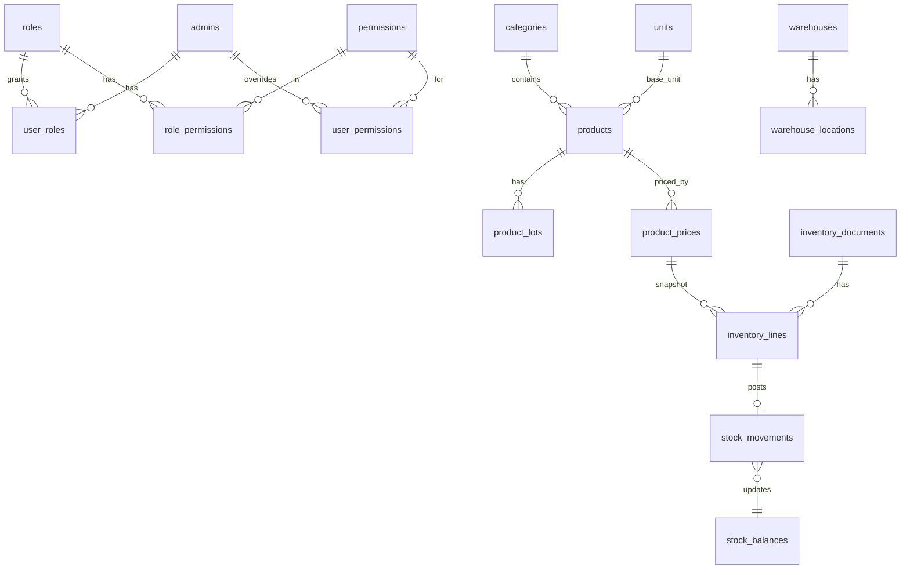

# PHP Admin: Quản lý sản phẩm, phân quyền và kho

Source PHP thuần + PDO + MySQL (Docker). Hệ thống gồm danh mục và sản phẩm, phân quyền theo nhóm và ngoại lệ tài khoản, kho (vị trí, lô), giá theo thời gian, phiếu nhập/xuất (nháp, ghi sổ, hủy, in), tồn kho và sổ biến động. Đặc tả và bài tập của thầy nằm ở [docs/DE_XUAT_MO_RONG.md](docs/DE_XUAT_MO_RONG.md) và [docs/BAI_TAP_SINH_VIEN.md](docs/BAI_TAP_SINH_VIEN.md).

## 1. Chức năng

**Có sẵn trong khung mẫu:** đăng nhập; danh mục và sản phẩm có ảnh, đơn vị cơ sở, tồn tối thiểu; phân trang thật trên database (giữ bộ lọc khi chuyển trang); phân quyền chức năng theo nhóm và ngoại lệ tài khoản; khai báo đơn vị, kho, vị trí, lô; lịch sử giá nhập/xuất theo khoảng `[valid_from, valid_to)` không chồng lấn; phiếu nhập/xuất nhiều dòng (nháp, ghi sổ hoặc hủy, chụp giá lúc lập phiếu); ghi sổ trong transaction, ngăn âm tồn và ghi trùng; in phiếu đã ghi sổ; dashboard tồn kho.

**Nhóm bổ sung:**
- **Sổ biến động** (`/movements`): lịch sử mọi lần ghi sổ nhập/xuất, lọc theo sản phẩm, kho, khoảng ngày phiếu; phân trang bằng `COUNT` + `LIMIT/OFFSET`, sắp xếp theo `m.id DESC` để thứ tự ổn định; chỉ đọc, không đổi tồn.
- **Hỏi dữ liệu kho bằng AI** (`/ai`, tuần 3): người dùng có quyền `ai.ask` đặt câu hỏi tiếng Việt; câu hỏi đi qua hàng đợi RabbitMQ, worker truy hồi schema (RAG), nhờ Ollama chạy local viết câu `SELECT`, kiểm tra rồi chạy bằng tài khoản MySQL chỉ đọc. Xem mục 11.
- **Lập giá kế tiếp** (bài mở rộng "đóng/mở lịch giá nguyên tử", ở trang `/prices`): đóng khoảng giá đang mở tại thời điểm T và tạo khoảng mới bắt đầu đúng T trong cùng một transaction.
  - T phải ở tương lai và sau thời điểm bắt đầu của khoảng đang mở; phải có đúng một khoảng đang mở của (sản phẩm, loại giá).
  - Khóa `products ... FOR UPDATE` (cùng khóa với thêm giá và lập phiếu), đọc khoảng đang mở sau khi có khóa; `UPDATE ... WHERE valid_to IS NULL` phải ảnh hưởng đúng một dòng, nếu không thì rollback.
  - Đơn giá đã chụp trên dòng phiếu không đổi; vì ngày chứng từ không thể ở tương lai nên không phiếu nào rơi vào từ T trở đi. Không đổi schema.

## 2. Chạy từ database mới

Yêu cầu: Docker Desktop (đang chạy), MySQL 8.0.16 trở lên (đã có trong `docker-compose.yml`). Các lệnh dưới đây chạy trong **PowerShell** tại thư mục gốc project (nơi có `docker-compose.yml`).

```powershell
docker compose up -d --build
docker compose logs mysql
```

Đợi MySQL khởi tạo xong (khoảng 20 đến 60 giây; lần đầu Docker tự chạy `database/init.sql`). Sau đó:
- Trang quản trị: http://localhost:8090
- phpMyAdmin: http://localhost:8091 (server `mysql`, tài khoản ứng dụng trong `.env`)

Cấu hình trong `.env`: `APP_URL=http://localhost:8090`, `DB_HOST=mysql`, `DB_DATABASE=admin_product_db`, `UPLOAD_MAX_SIZE=2097152` (2 MB). Cổng MySQL phía máy chủ là 3308, bên trong Docker là 3306 (không đổi cổng nội bộ).

Làm lại từ đầu (xóa toàn bộ dữ liệu): `docker compose down -v` rồi `docker compose up -d --build`.

## 3. Nâng cấp database tuần 1, giữ dữ liệu

Docker chỉ chạy `init.sql` khi volume MySQL còn trống, nên database cũ (chỉ có `admins`, `categories`, `products`) phải nâng cấp bằng migration `database/migrations/001_inventory_access.sql`, chạy **đúng một lần**. MySQL tự commit DDL nên nếu script lỗi giữa chừng thì không chạy lại; kiểm tra schema hoặc khôi phục từ bản sao lưu vào một database rỗng.

1. **Sao lưu** (dump trong container rồi chép ra, tránh lỗi mã hóa của PowerShell). Không đưa file này vào bài nộp:
   ```powershell
   docker compose exec mysql sh -c 'MYSQL_PWD=$MYSQL_ROOT_PASSWORD mysqldump -uroot --single-transaction $MYSQL_DATABASE > /tmp/backup-before-001.sql'
   docker compose cp mysql:/tmp/backup-before-001.sql .\backup-before-001.sql
   ```
2. **Dừng container, giữ volume** (không dùng `-v`): `docker compose down`
3. **Chép code tuần 2** đè lên thư mục project (`app`, `database`, `docs`, `tests`, `README.md`); giữ `.env`, `docker-compose.yml`, `docker\`.
4. **Chạy migration:**
   ```powershell
   docker compose up -d mysql
   Start-Sleep -Seconds 15
   docker compose cp .\database\migrations\001_inventory_access.sql mysql:/tmp/001.sql
   docker compose exec mysql sh -c 'MYSQL_PWD=$MYSQL_ROOT_PASSWORD mysql -uroot --default-character-set=utf8mb4 $MYSQL_DATABASE < /tmp/001.sql'
   ```
   Không có thông báo lỗi là thành công.
5. **Kiểm tra** (phải có bản ghi `001_inventory_access`, số sản phẩm không đổi, số dòng tồn bằng số sản phẩm có tồn lớn hơn 0):
   ```powershell
   @'
   SELECT * FROM schema_migrations;
   SELECT COUNT(*) AS so_san_pham FROM products;
   SELECT COUNT(*) AS so_dong_ton FROM stock_balances;
   '@ | Set-Content -Encoding ASCII .\verify.sql
   docker compose cp .\verify.sql mysql:/tmp/verify.sql
   docker compose exec mysql sh -c 'MYSQL_PWD=$MYSQL_ROOT_PASSWORD mysql -uroot $MYSQL_DATABASE < /tmp/verify.sql'
   Remove-Item .\verify.sql
   ```
6. **Bật ứng dụng:** `docker compose up -d --build`, đăng nhập `admin / admin123`.

Migration tạo lịch sử giá nhập và xuất từ giá cũ (giả định chuyển đổi, không phải giá vốn), phiếu nhập số dư đầu `OPENING-MIGRATION-001`, dòng sổ biến động và số dư kho `MAIN/DEFAULT/NOLOT`; dữ liệu gốc được giữ trong `legacy_product_stock_prices`. Các tài khoản `admins` cũ nhận nhóm ADMIN; migration không thêm `clerk`, `manager`, `viewer`.

## 4. Tài khoản và dữ liệu mẫu

| Tài khoản | Mật khẩu | Nhóm | Khả năng chính |
|---|---|---|---|
| `admin` | `admin123` | ADMIN | Tất cả quyền |
| `clerk` | `clerk123` | STOCK_CLERK | Xem, lập/hủy phiếu nháp, in; không ghi sổ |
| `manager` | `manager123` | STOCK_MANAGER | Xem, quản lý danh mục kho, ghi sổ, in; không lập phiếu |
| `viewer` | `viewer123` | VIEWER | Chỉ xem dashboard, sản phẩm, danh mục, tồn, phiếu |
| `tester` | `tester123` | (không nhóm) | Chỉ có sau khi nạp `bai_b_fixture.sql`, dùng thử phân quyền |

Mật khẩu chỉ dùng cho lớp học. Cài mới có sẵn `admin`, `clerk`, `manager`, `viewer`; database nâng cấp chỉ có `admin` cho đến khi nạp `bai_b_fixture.sql`.

**Dữ liệu thử** nằm trong `database/fixtures/`. Nạp từng file bằng (thay tên file):
```powershell
docker compose cp .\database\fixtures\bai_c_fixture.sql mysql:/tmp/bai_c_fixture.sql
docker compose exec mysql sh -c 'MYSQL_PWD=$MYSQL_ROOT_PASSWORD mysql -uroot --default-character-set=utf8mb4 $MYSQL_DATABASE < /tmp/bai_c_fixture.sql'
```

| File | Nội dung |
|---|---|
| `bai_b_fixture.sql` | Tạo `tester` (và `clerk`, `manager`, `viewer` nếu chưa có); chạy lại không bị trùng |
| `bai_c_fixture.sql` | 6 sản phẩm `GIA-...` với các khoảng giá từ 10/11/2026 |
| `bai_d_fixture.sql` | 2 kho, 2 sản phẩm `DS-A`, `DS-B`, lô `LOT-A1`, `LOT-A2` (hết hạn), `LOT-B1`, giá nhập/xuất |
| `bai_b_quyen_hieu_luc.sql`, `bai_d_doi_soat.sql` | Truy vấn bằng chứng (chỉ đọc): quyền hiệu lực; đối soát tồn |
| `sql_san_pham.sql` | 32 sản phẩm bổ sung cho **schema tuần 1** (cột `quantity`, `unit_price`); không chạy được trên schema tuần 2 |

## 5. Luồng thao tác và quy tắc nghiệp vụ

1. Danh mục kho: tạo đơn vị, kho, vị trí; lô quản lý riêng (sản phẩm mới tự có lô `NOLOT`).
2. Giá theo thời gian: tạo giá nhập và giá xuất có hiệu lực tại ngày dự kiến lập phiếu.
3. `clerk` lập phiếu nhập nháp; `manager` ghi sổ; tồn tăng đúng vị trí/lô. Phiếu xuất làm tương tự.
4. Mở phiếu đã ghi sổ và chọn In phiếu; có thể lưu PDF từ hộp thoại in của trình duyệt.

Quy tắc chính:
- Đơn giá do server lấy từ lịch sử giá theo loại phiếu và ngày phiếu; phiếu nháp chưa đổi tồn; giá được chụp lúc lập nháp và giữ nguyên.
- Phiếu đã ghi sổ bất biến; phiếu nháp sai phải hủy rồi tạo lại. Ghi sổ lặp không tạo biến động thứ hai.
- Xuất vượt tồn, hoặc lô đã hết hạn, bị từ chối cả phiếu (không ghi sổ một phần).
- Khoảng giá `[valid_from, valid_to)`: cho phép hai khoảng tiếp giáp, không cho chồng lấn. Khoảng không có ngày kết thúc chặn các khoảng sau, trừ khi dùng "Lập giá kế tiếp".
- Số lượng là số nguyên theo đơn vị cơ sở; sau khi có dòng phiếu thì không đổi đơn vị cơ sở. Ngày phiếu không ở tương lai; lùi ngày chỉ để chọn giá, ghi sổ luôn xét số dư hiện tại.
- Đối soát: với mỗi bộ khóa (sản phẩm, vị trí, lô), `stock_balances.quantity = SUM(stock_movements.quantity)`.

## 6. Route và quyền

Mọi route nghiệp vụ cần đăng nhập; POST thay đổi dữ liệu cần CSRF; quyền được kiểm tra ở server và đọc từ database ở mỗi request (thu hồi quyền có hiệu lực ngay).

| Route | Phương thức | Quyền |
|---|---|---|
| `/login` | GET, POST | Công khai |
| `/logout` | POST | Đã đăng nhập |
| `/dashboard` | GET | `dashboard.view` |
| `/products` | GET | `products.view` |
| `/products/create`, `/products/edit`, `/products/delete` | GET, POST | `products.manage` |
| `/categories` | GET | `categories.view` |
| `/categories/create`, `/categories/edit`, `/categories/delete` | GET, POST | `categories.manage` |
| `/warehouse-catalog` | GET, POST | `warehouse.manage` |
| `/prices` | GET | `prices.view` |
| `/prices` (thêm khoảng giá, lập giá kế tiếp) | POST | `prices.manage` |
| `/inventory` | GET | `inventory.view` |
| `/movements` | GET | `inventory.view` |
| `/documents`, `/documents/show` | GET | `documents.view` |
| `/documents/create?type=receipt` | GET, POST | `receipts.create` |
| `/documents/create?type=issue` | GET, POST | `issues.create` |
| `/documents/post` | POST | `receipts.post` hoặc `issues.post` theo loại phiếu |
| `/documents/cancel` | POST | `receipts.create` hoặc `issues.create` theo loại phiếu |
| `/documents/print` | GET | `documents.print` (phiếu phải đã ghi sổ) |
| `/access` | GET, POST | `access.manage` |
| `/ai` | GET | `ai.ask` |
| `/ai/ask` | POST | `ai.ask` (CSRF, tối đa 3 câu chưa xong mỗi người) |
| `/ai/status` | GET | `ai.ask` (chỉ đọc job của chính mình) |

Thứ tự quyết định quyền: **từ chối riêng > cho phép riêng > hợp quyền các nhóm > từ chối mặc định**. Chọn "Kế thừa nhóm" thì xóa ngoại lệ của tài khoản. Hệ thống chặn người thao tác tự thu hồi `access.manage` và luôn giữ ít nhất một người quản lý phân quyền. `/documents/post` và `/documents/cancel` kiểm tra quyền bên trong `document_post()` và `document_cancel()` (trước khi kiểm tra trạng thái phiếu).

## 7. Sơ đồ quan hệ (rút gọn)



## 8. Kiểm thử

- Bảng ca kiểm thử, dữ liệu đầu vào, kết quả mong đợi và thực tế: [docs/KIEM_THU.md](docs/KIEM_THU.md) (tuần 2) và [docs/KIEM_THU_AI.md](docs/KIEM_THU_AI.md) (tuần 3).
- Đối soát tồn: `database/fixtures/bai_d_doi_soat.sql` (cột `lech` phải bằng 0).
- Phép thử cạnh tranh (hai tiến trình PHP, hai tài khoản, hai kết nối DB): cần đã nạp `bai_b_fixture.sql` và `bai_d_fixture.sql`:
  ```powershell
  docker compose cp .\tests\concurrency_post.php php-app:/tmp/concurrency_post.php
  docker compose exec php-app php /tmp/concurrency_post.php
  ```
- Kiểm thử tích hợp của thầy: `tests/run.sh` (cần `sh` và Python 3 trên máy chủ), chạy trên database riêng `admin_product_test`, không đụng dữ liệu thật.

## 9. Giới hạn còn lại

- Đã làm bài mở rộng "đóng/mở lịch giá nguyên tử". Các bài mở rộng khác chưa làm: quyền theo kho, tách người lập/người duyệt, chuyển kho, đảo phiếu và trả hàng, quy đổi đơn vị, giá vốn, quản lý tài khoản và nhật ký đổi quyền.
- Phép thử cạnh tranh gọi lớp nghiệp vụ qua hai tiến trình PHP, không gửi qua HTTP.
- Tuần 3: chưa làm báo cáo Markdown/PDF (`/reports`, Dompdf). Mô hình `qwen2.5:3b` có thể viết SQL sai hoặc hiểu thiếu ý câu hỏi; truy hồi chỉ theo từ khóa (chưa dùng embedding); chỉ chạy được một worker; trạng thái cập nhật bằng polling. Chi tiết ở mục 11 và [docs/AI_TUAN3.md](docs/AI_TUAN3.md).
- Tài liệu của thầy ghi `/documents/print` cần cả `documents.view` và `documents.print`, nhưng code chỉ kiểm tra `documents.print`.

## 10. Cấu trúc thư mục

```text
app/public/index.php          Router và xử lý request
app/public/assets/            CSS, JavaScript, định dạng in
app/src/                      PDO, xác thực, quyền, repository/nghiệp vụ
app/src/ai_service.php        AI: hàng đợi, RAG, Ollama, kiểm tra SELECT
app/src/ai/schema_context.md  Tài liệu schema dùng cho truy hồi (RAG)
app/bin/                      ai_worker.php (worker RabbitMQ), ai_selftest.php
app/views/                    Giao diện
database/init.sql             Schema + dữ liệu demo cho cài mới
database/migrations/          001_inventory_access.sql (nâng cấp từ tuần 1, chạy một lần)
                              002_ai_reports.sql (bảng ai_jobs và quyền AI, chạy một lần)
database/grant_ai_reader.ps1  Cấp tài khoản MySQL chỉ đọc cho AI (PowerShell)
database/sample_data/         ai_inventory_demo.sql (500 sản phẩm mẫu, tùy chọn)
database/fixtures/            Dữ liệu thử và truy vấn bằng chứng
docs/                         Đặc tả, bài tập, bảng kiểm thử
tests/                        Kiểm thử tích hợp, HTTP, cạnh tranh
```

## 11. Hỏi dữ liệu kho bằng AI (tuần 3: Ollama, RabbitMQ, RAG)

### 11.1 Thành phần

| Service | Vai trò | Cổng máy chủ |
|---|---|---|
| `ollama` | Chạy mô hình ngôn ngữ cục bộ (`qwen2.5:3b`), không gọi dịch vụ AI trên Internet | 11434 |
| `rabbitmq` | Hàng đợi bền vững `ai_jobs` | 15672 (trang quản trị) |
| `ai-worker` | Lấy việc từ hàng đợi, chạy RAG + Ollama, ghi kết quả vào MySQL | không có |

Luồng: trình duyệt gửi câu hỏi → PHP ghi `ai_jobs` (queued) và đưa UUID vào hàng đợi → worker nhận, truy hồi các đoạn schema liên quan, gọi Ollama sinh `SELECT`, kiểm tra, chạy bằng tài khoản chỉ đọc → trang `/ai` hỏi trạng thái mỗi 2,5 giây. Kiến trúc đầy đủ và các lớp an toàn: [docs/AI_TUAN3.md](docs/AI_TUAN3.md).

### 11.2 Cài đặt (PowerShell, tại thư mục gốc project)

`database/init.sql` của project **chưa gồm** migration 002, nên cả cài mới lẫn nâng cấp đều phải chạy bước 2.

1. Thêm vào `.env` (mật khẩu chỉ gồm chữ, số, `_` hoặc `-`; không nộp file `.env`):
   ```dotenv
   OLLAMA_URL=http://ollama:11434
   OLLAMA_MODEL=qwen2.5:3b
   RABBITMQ_HOST=rabbitmq
   RABBITMQ_PORT=5672
   RABBITMQ_USER=report_worker
   RABBITMQ_PASSWORD=<mật khẩu riêng>
   RABBITMQ_QUEUE=ai_jobs
   AI_DB_HOST=mysql
   AI_DB_PORT=3306
   AI_DB_DATABASE=admin_product_db
   AI_DB_USERNAME=ai_reader
   AI_DB_PASSWORD=<mật khẩu riêng khác>
   ```
2. Chạy migration 002 **đúng một lần** (tạo bảng `ai_jobs`, quyền `ai.ask` và `reports.view` cho nhóm ADMIN và VIEWER):
   ```powershell
   docker compose cp .\database\migrations\002_ai_reports.sql mysql:/tmp/002.sql
   docker compose exec mysql sh -c 'MYSQL_PWD=$MYSQL_ROOT_PASSWORD mysql -uroot --default-character-set=utf8mb4 $MYSQL_DATABASE < /tmp/002.sql'
   ```
3. Cấp tài khoản MySQL chỉ đọc (SELECT trên 11 bảng nghiệp vụ, không có `admins` và bảng quyền):
   ```powershell
   powershell -ExecutionPolicy Bypass -File .\database\grant_ai_reader.ps1
   ```
4. Build và bật (lần đầu cài thư viện RabbitMQ nên chậm), rồi tải mô hình một lần (khoảng 1,9 GB):
   ```powershell
   docker compose up -d --build
   docker compose exec ollama ollama pull qwen2.5:3b
   docker compose logs ai-worker
   ```
   Log của `ai-worker` phải có dòng "Worker sẵn sàng".
5. Tự kiểm tra bộ kiểm tra SQL và bộ truy hồi (không cần Ollama), phải in "TẤT CẢ ĐẠT":
   ```powershell
   docker compose exec php-app php /var/www/html/bin/ai_selftest.php
   ```
6. Dữ liệu mẫu lớn (tùy chọn, **làm sau** khi chụp bằng chứng tuần 2 vì sẽ tăng số sản phẩm lên 545; chỉ chạy một lần):
   ```powershell
   docker compose cp .\database\sample_data\ai_inventory_demo.sql mysql:/tmp/demo.sql
   docker compose exec mysql sh -c 'MYSQL_PWD=$MYSQL_ROOT_PASSWORD mysql -uroot --default-character-set=utf8mb4 $MYSQL_DATABASE < /tmp/demo.sql'
   ```

### 11.3 Sử dụng và kiểm chứng

- Đăng nhập `admin / admin123`, mở menu **Hỏi dữ liệu AI** (`/ai`). Tài khoản không có quyền `ai.ask` (ví dụ `tester`) nhận 403.
- Đối chiếu kết quả AI với `/inventory`, `/movements` và `/prices`; mô hình có thể sai.
- Chứng minh xử lý bất đồng bộ: `docker compose stop ai-worker`, gửi một câu hỏi (trang đứng ở `queued`, RabbitMQ `ai_jobs` có message Ready), rồi `docker compose start ai-worker` (job tự hoàn tất, Ready về 0).
- Bảng ca kiểm thử và kết quả thực tế: [docs/KIEM_THU_AI.md](docs/KIEM_THU_AI.md).

### 11.4 Quản trị RabbitMQ và giới hạn

Trang quản trị RabbitMQ ở `http://localhost:15672` (đăng nhập bằng `RABBITMQ_USER` và `RABBITMQ_PASSWORD` trong `.env`). Không mở cổng 11434 và 15672 ra Internet.
